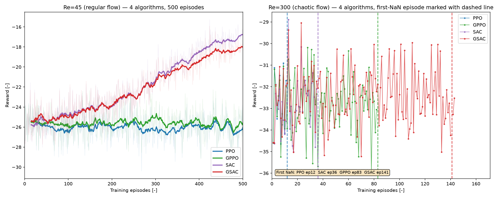
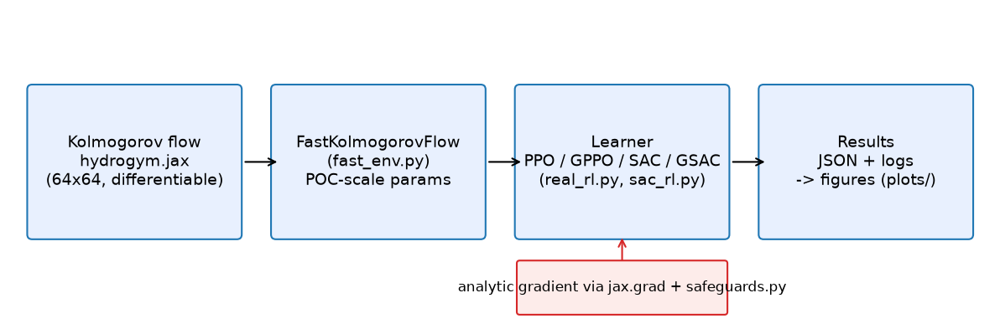
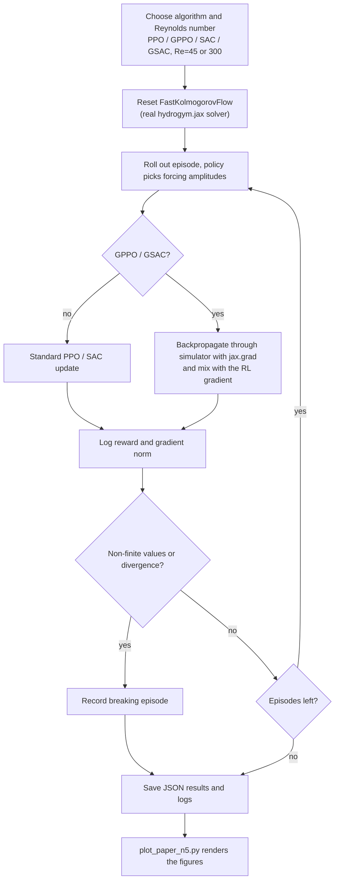
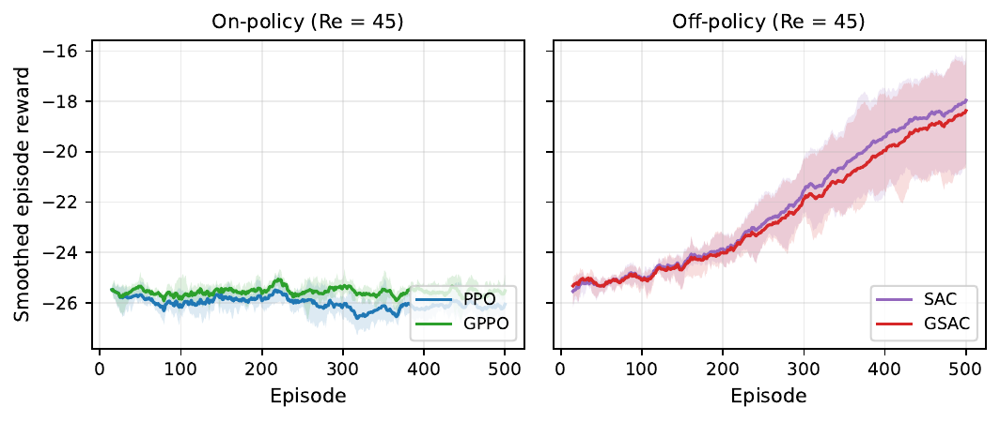
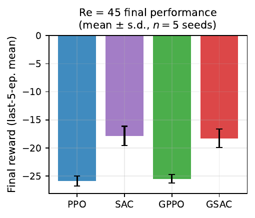
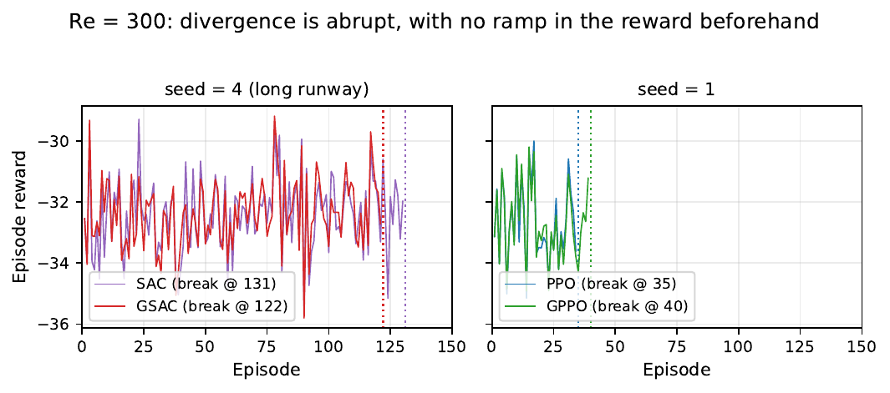
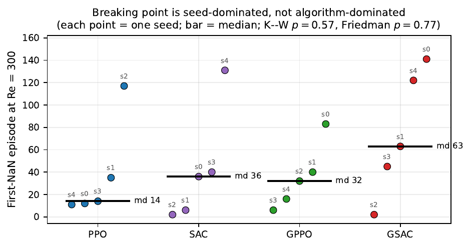
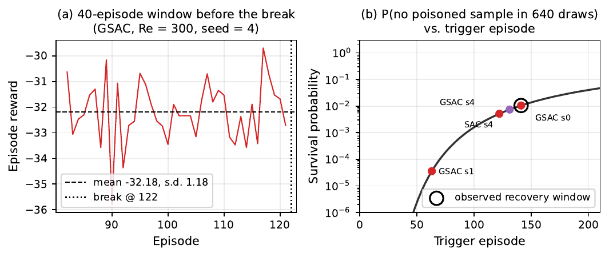
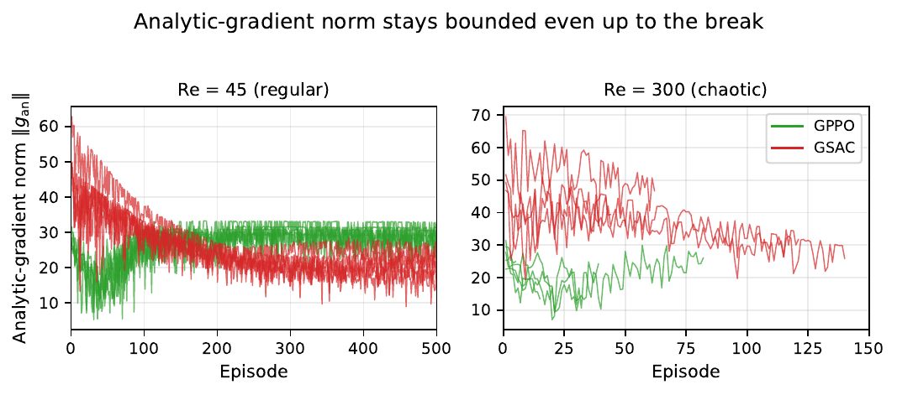

# HydroGym analytic-gradient RL on chaotic Kolmogorov flow

🇬🇧 English · 🇹🇷 [Türkçe](README.tr.md)

**Does injecting an analytic (backpropagated-through-the-simulator) policy gradient help or hurt reinforcement learning as a fluid-flow control task becomes chaotic?**

We compare PPO, GPPO, SAC and a gradient-enhanced SAC (GSAC) on the real `hydrogym.jax` Kolmogorov-flow environment at a regular (Re=45) and a chaotic (Re=300) operating point over five seeds. This repository is a fork of [dynamicslab/hydrogym](https://github.com/dynamicslab/hydrogym) (see [README_UPSTREAM.md](README_UPSTREAM.md)) with our experiment code added.



*Training curves of PPO, GPPO, SAC and GSAC at both Reynolds numbers.*

## Summary

| Problem | Method | Simulation / hardware | Paper |
|---|---|---|---|
| Effect of analytic-gradient injection on RL stability in regular vs. chaotic flow control | PPO, GPPO, SAC, GSAC; 5 seeds; exact permutation test | `hydrogym.jax` KolmogorovFlow (64x64), single consumer NVIDIA GPU | [paper/hydrogym-edge-of-chaos.pdf](paper/hydrogym-edge-of-chaos.pdf) |

### System architecture



The real HydroGym Kolmogorov solver is wrapped by `FastKolmogorovFlow` (POC-scale time step and horizon); the learners live in `real_rl.py` and `sac_rl.py`, and results are stored as JSON and rendered into figures.

### Flow diagram (how it works)



## Selected results

### Result 1: Regular regime (Re=45): training curves

GPPO reaches PPO's best reward in substantially fewer episodes in 4 of 5 seeds, reproducing the mechanism reported by the HydroGym paper.



### Result 2: Regular regime (Re=45): final reward

Final reward of the four algorithms over five seeds.



### Result 3: Chaotic regime (Re=300): training curves

All four algorithms eventually diverge.



### Result 4: Chaotic regime (Re=300): breaking episode

The first-divergence episode is dominated by the seed, not the algorithm: an exact permutation test separates no pair of algorithms (all p >= 0.19).



### Result 5: Mechanism of the break

The break is sudden and precursor-free; the replay buffer size at the trigger decides whether a brief post-trigger survival window appears.



### Result 6: Analytic-gradient norms

Gradient-norm behaviour that accompanies the chaotic-regime break.



*All figures are in the `plots/` folder.*

## Installation

Requirements: Linux, Python 3.10 or 3.11, NVIDIA GPU with driver >= 550 (no system CUDA needed), about 8 GB of free disk.

```bash
git clone https://github.com/GulogluHaktan/hydrogym-work.git
cd hydrogym-work/hydrogym_real   # if the repo root is hydrogym_real itself, stay in the root
bash setup_env.sh                # creates ../venv with GPU JAX (about 6 GB)
source ../venv/bin/activate
python -c "import jax, hydrogym.jax; print(jax.devices())"
```

## Usage

Run a short single configuration (PPO at Re=45, 25 episodes):

```bash
python run_real_experiment.py --episodes 25 --only ppo_low --out results_demo.json
```

Expected output: periodic per-episode log lines (reward, gradient norm) and a `results_demo.json` file.

## Reproducing the results

| Figure | Command |
|---|---|
| Results 1-4, mechanism and gradient-norm figures (`plots/sonuc_1..6.png`) | `python plot_paper_n5.py` (writes `paper_tex/figures/fig_*.pdf`) |
| Data for seeds 1-4 (about 8.5 h per seed) | `bash run_seed_sweep.sh <SEED>` |
| Data for seed 0 | `bash run_ppo_gppo_500_sequential.sh` then `bash run_sac_gsac_500_sequential.sh` (edit the hard-coded `cd` path first) |

Result JSON files for all seeds are included, so the figures can be regenerated without re-training.

## Project structure

```
hydrogym_real/
├── assets/                # README images
├── hydrogym/              # upstream HydroGym library (fork), see README_UPSTREAM.md
├── plots/                 # result figures sonuc_1..6.png
├── paper/                 # manuscript PDF
├── paper_jai/             # LaTeX source (Journal of Automation and Intelligence)
├── paper_tex/             # LaTeX source (elsarticle) + figures/
├── fast_env.py            # FastKolmogorovFlow: POC-scale parameters for the real env
├── real_rl.py             # PPO / GPPO
├── sac_rl.py              # SAC / GSAC
├── safeguards.py          # gradient clipping, non-finite fallback, warm-up, adaptive mix
├── run_real_experiment.py # PPO/GPPO driver
├── run_sac_experiment.py  # SAC/GSAC driver
├── run_seed_sweep.sh      # full 8-config sweep for one seed
├── plot_paper_n5.py       # figures of the manuscript (seeds 0-4)
├── results_500_*.json     # per-config results (500 episodes)
├── log_500_*.log          # training logs
├── requirements.txt
└── README.md
```

## Citation, license and contact

```bibtex
@misc{ozkurt2026gradient,
  title  = {Gradient at the Edge of Chaos: Why Analytic-Gradient Reinforcement
            Learning Has No Seed-Robust Advantage on Chaotic Kolmogorov Flow},
  author = {{\"O}zkurt, Cem and Onay, Muhammed Emin and Tun{\c{c}}, Ey{\"u}p Altu{\u{g}}
            and K{\"u}{\c{c}}{\"u}kler, Ahmet Kutay and G{\"u}lo{\u{g}}lu, Haktan Yusuf},
  year   = {2026},
  note   = {Manuscript in preparation. Code archive DOI: TODO (Zenodo)}
}
```

License: MIT (see [LICENSE](LICENSE), inherited from upstream HydroGym).
Contact: Cem Özkurt (corresponding author), cemozkurt@sakarya.edu.tr.
