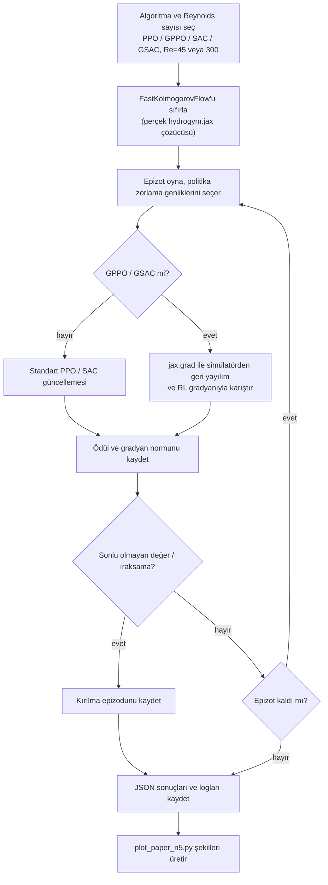

# Kaotik Kolmogorov akışında HydroGym analitik-gradyan RL

🇬🇧 [English](README.md) · 🇹🇷 Türkçe

**Akış kontrol görevi kaotikleştikçe analitik (simülatörden geri yayılımlı) politika gradyanı eklemek pekiştirmeli öğrenmeye yarar mı, zarar mı verir?**

PPO, GPPO, SAC ve gradyan destekli SAC (GSAC) algoritmalarını gerçek `hydrogym.jax` Kolmogorov akışı ortamında, düzenli (Re=45) ve kaotik (Re=300) çalışma noktalarında, beş seed üzerinde karşılaştırıyoruz. Bu depo [dynamicslab/hydrogym](https://github.com/dynamicslab/hydrogym) çatalıdır (bkz. [README_UPSTREAM.md](README_UPSTREAM.md)) ve deney kodumuz eklenmiştir.


*PPO, GPPO, SAC ve GSAC'ın iki Reynolds sayısındaki eğitim eğrileri.*

## Özet

| Problem | Yöntem | Simülasyon / donanım | Makale |
|---|---|---|---|
| Analitik gradyan eklemenin düzenli ve kaotik akış kontrolünde RL kararlılığına etkisi | PPO, GPPO, SAC, GSAC; 5 seed; kesin permütasyon testi | `hydrogym.jax` KolmogorovFlow (64x64), tek tüketici NVIDIA GPU | [paper/hydrogym-edge-of-chaos.pdf](paper/hydrogym-edge-of-chaos.pdf) |

### Sistem mimarisi


Gerçek HydroGym Kolmogorov çözücüsü `FastKolmogorovFlow` ile sarılır (POC ölçekli zaman adımı ve ufuk); öğreniciler `real_rl.py` ve `sac_rl.py` içindedir, sonuçlar JSON olarak saklanıp şekillere dönüştürülür.

### Akış şeması (nasıl çalışır)



## Seçilmiş sonuçlar

### Sonuç 1: Düzenli rejim (Re=45): eğitim eğrileri

GPPO, 5 seed'in 4'ünde PPO'nun en iyi ödülüne belirgin biçimde daha az epizotta ulaşıyor; HydroGym makalesinde bildirilen mekanizma yeniden üretiliyor.


### Sonuç 2: Düzenli rejim (Re=45): son ödül

Dört algoritmanın beş seed üzerindeki son ödülü.


### Sonuç 3: Kaotik rejim (Re=300): eğitim eğrileri

Dört algoritma da sonunda ıraksıyor.


### Sonuç 4: Kaotik rejim (Re=300): kırılma epizodu

İlk ıraksama epizodunu algoritma değil seed belirliyor: kesin permütasyon testi hiçbir algoritma çiftini ayıramıyor (hepsi p >= 0,19).


### Sonuç 5: Kırılmanın mekanizması

Kırılma ani ve öncül işaretsiz; tetikleme anındaki replay buffer boyutu, tetiklemeden sonra kısa bir hayatta kalma penceresi açılıp açılmayacağını belirliyor.


### Sonuç 6: Analitik gradyan normları

Kaotik rejimdeki kırılmaya eşlik eden gradyan normu davranışı.


*Tüm şekiller `plots/` klasöründe.*

## Kurulum

Gereksinimler: Linux, Python 3.10 veya 3.11, sürücüsü >= 550 olan NVIDIA GPU (sistem CUDA gerekmez), yaklaşık 8 GB boş disk.

```bash
git clone https://github.com/GulogluHaktan/hydrogym-work.git
cd hydrogym-work/hydrogym_real   # depo kökü doğrudan hydrogym_real ise kökte kal
bash setup_env.sh                # GPU JAX ile ../venv oluşturur (yaklaşık 6 GB)
source ../venv/bin/activate
python -c "import jax, hydrogym.jax; print(jax.devices())"
```

## Kullanım

Kısa tek konfigürasyon çalıştırma (Re=45'te PPO, 25 epizot):

```bash
python run_real_experiment.py --episodes 25 --only ppo_low --out results_demo.json
```

Beklenen çıktı: epizot başına düzenli log satırları (ödül, gradyan normu) ve bir `results_demo.json` dosyası.

## Sonuçları yeniden üret

| Şekil | Komut |
|---|---|
| Sonuç 1-4, mekanizma ve gradyan normu şekilleri (`plots/sonuc_1..6.png`) | `python plot_paper_n5.py` (`paper_tex/figures/fig_*.pdf` yazar) |
| Seed 1-4 verisi (seed başına yaklaşık 8,5 saat) | `bash run_seed_sweep.sh <SEED>` |
| Seed 0 verisi | `bash run_ppo_gppo_500_sequential.sh` ardından `bash run_sac_gsac_500_sequential.sh` |

Tüm seed'lerin sonuç JSON dosyaları depoda olduğundan şekiller yeniden eğitim yapmadan üretilebilir.

## Proje yapısı

```
hydrogym_real/
├── assets/                # README images
├── hydrogym/              # upstream HydroGym library (fork), see README_UPSTREAM.md
├── plots/                 # result figures sonuc_1..6.png
├── paper/                 # manuscript PDF
├── paper_jai/             # LaTeX source (Journal of Automation and Intelligence)
├── paper_tex/             # LaTeX source (elsarticle) + figures/
├── fast_env.py            # FastKolmogorovFlow: POC-scale parameters for the real env
├── real_rl.py             # PPO / GPPO
├── sac_rl.py              # SAC / GSAC
├── safeguards.py          # gradient clipping, non-finite fallback, warm-up, adaptive mix
├── run_real_experiment.py # PPO/GPPO driver
├── run_sac_experiment.py  # SAC/GSAC driver
├── run_seed_sweep.sh      # full 8-config sweep for one seed
├── plot_paper_n5.py       # figures of the manuscript (seeds 0-4)
├── results_500_*.json     # per-config results (500 episodes)
├── log_500_*.log          # training logs
├── requirements.txt
└── README.md
```

## Atıf, lisans ve iletişim

```bibtex
@misc{ozkurt2026gradient,
  title  = {Gradient at the Edge of Chaos: Why Analytic-Gradient Reinforcement
            Learning Has No Seed-Robust Advantage on Chaotic Kolmogorov Flow},
  author = {{\"O}zkurt, Cem and Onay, Muhammed Emin and Tun{\c{c}}, Ey{\"u}p Altu{\u{g}}
            and K{\"u}{\c{c}}{\"u}kler, Ahmet Kutay and G{\"u}lo{\u{g}}lu, Haktan Yusuf},
  year   = {2026},
  note   = {Manuscript in preparation. Code archive DOI: TODO (Zenodo)}
}
```

Lisans: MIT ([LICENSE](LICENSE), upstream HydroGym'den devralındı).
İletişim: Cem Özkurt (sorumlu yazar), cemozkurt@sakarya.edu.tr.
